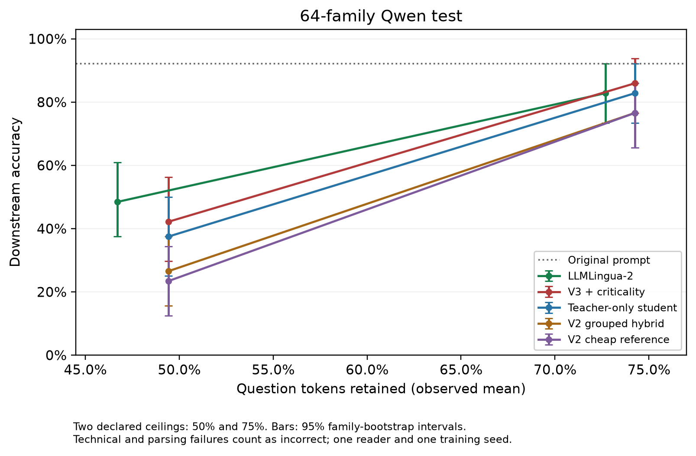
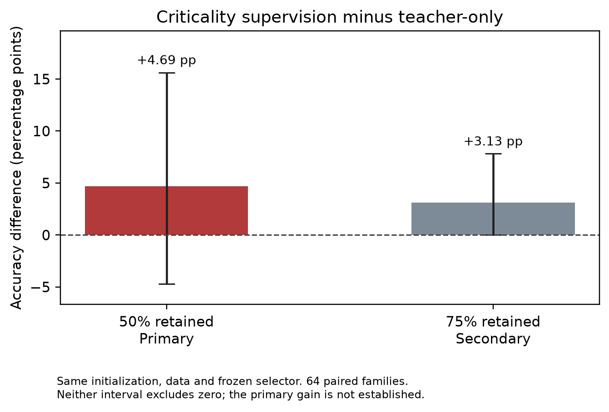

# Symbiote: final results, methods and conclusion

**Experimental status: complete. Final research model: combined v3. Added criticality benefit and overall baseline superiority: not established.**

The current guide is [README.md](README.md). All v3 values below are from the
completed, independently audited 30 October run; no new reader calls were made
for this publication. Earlier v2 scores, provenance and compute records remain under
`results/tables/`, `results/metadata/` and `results/profiles/`; relevant findings
are consolidated below.

## V3: one Qwen reader, 64 held-out families

Original accuracy: **59/64 = 92.19%**. Each family contributes one question.

| Method | 50% tokens retained | 75% tokens retained |
| --- | ---: | ---: |
| V3 + criticality | 27/64 (42.19%) | 55/64 (85.94%) |
| Teacher-only control | 24/64 (37.50%) | 53/64 (82.81%) |
| V2 grouped hybrid | 17/64 (26.56%) | 49/64 (76.56%) |
| V2 cheap reference | 15/64 (23.44%) | 49/64 (76.56%) |
| LLMLingua-2 | 31/64 (48.44%) | 53/64 (82.81%) |

Primary contrast, criticality minus matched teacher-only at 50% retention:
**+4.69 pp; paired 95% CI [-4.69, +15.63]**. No established added criticality gain.
At 75% retention the point difference is +3.13 pp [0.00, +7.81]; secondary.
V3 exceeds LLMLingua-2 by two questions at 75%, loses by four at 50%, and does not
establish overall baseline superiority. Token ceilings are shared; actual average
retention is not identical. Failures count wrong rather than being dropped.

## Tables and report-ready figures

| Artifact | What it contains |
| --- | --- |
| [test/accuracy.csv](results/v3/20261030/test/accuracy.csv) | All method/budget scores, actual retention and accuracy intervals |
| [test/paired.csv](results/v3/20261030/test/paired.csv) | Paired contrasts; secondary comparisons are exploratory |
| [test/per_task.csv](results/v3/20261030/test/per_task.csv) | Per-task counts; cohort is uneven and includes only two navigation questions |
| [test/coverage.csv](results/v3/20261030/test/coverage.csv) | Parsing/technical failures and budget checks |
| [test/reader_usage.csv](results/v3/20261030/test/reader_usage.csv) | Logical-condition token/cost estimates; caching means these are not additive invoice totals |
| [dev/summary.json](results/v3/20261030/dev/summary.json) | Development results; shared word-policy selection used teacher-only counts |
| [per_question.csv](results/v3/20261030/per_question.csv) | All 1,184 main dev/test logical conditions with final answers and outcomes |
| [answer_failures.csv](results/v3/20261030/answer_failures.csv) | Format/technical failures for auditing; not silently repaired to improve scores |
| [verification.json](results/v3/20261030/verification.json) | File/source/split/budget/grading/primary-interval audit |
| [checkpoint_smoke.json](results/v3/20261030/checkpoint_smoke.json) | Both real models load on CPU and reproduce one saved development compression |
| [metadata/benchmark.json](results/v3/20261030/metadata/benchmark.json) | Full warm-compressor timings on 8 validation questions, 2 repeats, T4 |
| [metadata/models/](results/v3/20261030/metadata/models/) | Actual training histories and checkpoint hashes |
| [claims.csv](results/v3/20261030/claims.csv) | Allowed claims and qualifications |
| [figures/](results/v3/20261030/figures/) | PNG and PDF versions of the two figures |

Warm median compression times: combined v3 **11.33 ms**, v2 hybrid **47.90 ms**,
LLMLingua-2 with official-controls budget enforcement **109.99 ms**. This is a
small controlled microbenchmark, not an end-to-end API latency/savings guarantee.
Absolute CUDA peaks include any other resident allocations; do not call them
isolated per-model memory requirements.

Conservative guard ledger: **INR201.96**. Estimate from known reported tokens at
declared quote rates: **INR126.28**, plus one attempt of unknown usage. Actual
provider billing is not reconciled. Full responses, usage, weights and exact
executed source remain in the ignored returned archive; see README for paths.

## Historical evidence

- Original/mid-evaluation implementation: `src/`; historical notes are archived.
- Corrected v2 study: `results/tables/`, `results/metadata/`, `results/figures/`.
- Controlled old-vs-v2 and component/bonus/mask-delete follow-ups:
  `results/followup/` and `results/followup_v2/`, summarized below.
- Exploratory outcomes and reproduction metadata: [summary.json](results/exploratory_20261029/summary.json).

Historical percentages belong to their own readers/cohorts/protocols. They are
not a direct before/after comparison to the new 64-family test.

## Complete project conclusion and report handoff

**The empirical project is complete; the claim that criticality supervision
improves compression accuracy is not established.** This is a result of testing
the proposal, rather than an experiment still waiting to be run.

Use **Symbiote v3 (teacher + criticality)** as the single final research artifact.
Keep the teacher-only checkpoint as its control and v1/v2 as historical evidence.
This release choice preserves the investigated method; it is not a claim that
the test proved this checkpoint optimal or universally better than a baseline.
Its local checkpoint is
`outputs/imports/v3_20261030_completed/run/models/teacher_cf/best.pt`.
The architecture requires the v3 loader, not the old span-scorer loader.

The defensible answer to each research question is:

| Question | Evidence | Conclusion |
| --- | --- | --- |
| Can we learn the recovered counterfactual span labels? | Neural AUC .9074 versus ridge .8217 and category prior .7515 on the same held-out occurrences | Yes, the operational sensitivity labels are predictable beyond simple features |
| Is criticality identical across labelers? | Pairwise agreement 82.1-85.0%, kappa .487-.578 on common eligible observations | Agreement is substantial but imperfect; universal/model-independent necessity is not established |
| Does correcting the original scorer produce a downstream accuracy gain? | Controlled historical-v2 paired intervals all include zero | No gain established; correctness fixes do not imply accuracy gains |
| Does the old criticality/surprisal compressor beat LLMLingua-2? | Completed 160-question baseline study, both readers and budgets | No; LLMLingua-2 has higher pooled accuracy in this study |
| Does v3 improve on the old compressor? | Same new 64-family test: 27 vs 17 at .50; 55 vs 49 at .75 | Higher point accuracy for v3; secondary exploratory comparison, not a criticality-specific attribution |
| Do criticality labels add value to the matched dense student? | Primary +4.69 pp, CI [-4.69, +15.63] | Not demonstrated; neither a positive effect nor equivalence/absence of effect is established |
| Does v3 beat LLMLingua-2 overall? | V3 27 vs 31 at .50; 55 vs 53 at .75 | No overall superiority established |

**Report-ready conclusion:** We constructed and audited a cross-model
counterfactual span-sensitivity dataset and trained a lightweight scorer that
predicts these labels better than category and feature baselines. This predictive
success did not establish a downstream advantage for the original hybrid
compressor. A dense student combining teacher retention labels with criticality
supervision improved point accuracy over the earlier compressor on a new paired
cohort and compressed without reader calls. However, its matched teacher-only
ablation did not establish an incremental benefit from criticality supervision,
and it did not consistently outperform LLMLingua-2. Under the tested setup,
single-span sensitivity is a useful learnable diagnostic, but is not sufficient
evidence of a better multi-deletion compression policy.

The last statement is an empirical limitation, not a proof that criticality can
never help. Training masks one span in a largely intact question, whereas
compression deletes many items together. That objective mismatch is a plausible
explanation, supported by the design and small diagnostics, not a proven sole
cause. V3's span loss trains the shared encoder; its selected word policy does
not directly consult the span head or guarantee indivisible span retention.

At .75 the final model is a useful measured tradeoff: 85.94% overall accuracy
versus 92.19% for full questions, with roughly 25% of question tokens deleted.
At .50 it drops to 42.19%; aggressive compression is poor on this cohort.
Neither result supports a user-facing 90% accuracy guarantee.

## Model versions and training differences

| Version | Supervision and model | Inference and purpose |
| --- | --- | --- |
| Original / mid-eval | DistilBERT contextual mean-pooled span scorer; historical source already supports soft votes and optional weighted BCE | Span criticality plus DistilGPT2 surprisal and structural bonuses; whitespace-word deletion; historical checkpoint |
| Corrected v2 | Same span-scoring approach; recovered votes deduplicated/regraded, eligibility enforced; reliable soft fractions; unweighted BCE; five family-disjoint folds | Shared extraction, checked token ceilings, original-style and grouped variants, matched cheap reference; corrected reproduction, not a new data collection |
| V3 teacher-only control | DistilBERT word and span heads; word-retention BCE from cached LLMLingua-2 .50 outputs, no span loss | Frozen shared word selector, exact question-token ceiling; experimental control |
| Final v3 teacher + criticality | Identical initialization/architecture/data; word BCE + 0.2 x corrected span-soft-target BCE | Same selector; span supervision affects shared encoder during training; final research artifact |

V2 corrected **1,125 shared perturbed vote outcomes** and excluded **624
original-answer failures** from label eligibility. These are vote counts, not
1,125 questions. Original source and mid-eval slides already describe soft
targets: do not describe the entire change as "hard labels became soft".
Nor should v2 be renamed the checkpoint used at mid-eval. It is legitimate to
call it a *corrected reproduction of the original approach*, with the actual
chronology and checkpoint identifiers disclosed.

Both v3 arms have 66,364,418 parameters, four epochs, batch 8, learning rate
3e-5, seed 42, and the same initial encoder/head weights. Training uses 656
questions/639 families, validation 168/113; downstream dev and test use one
representative per 32 and 64 families respectively. There are 43,512 usable
teacher word targets and 11,953 span targets. Ambiguous teacher alignments and
missing span labels are masked, not treated as negatives. Validation teacher
BCE selects epoch 3 for the control and epoch 2 for combined v3. Teacher-only
development accuracy chooses the same word policy for both arms. Test accuracy
does not choose the epoch or selector. See the v3 metadata links above.

Scorer/signal/hybrid in v1/v2 are **compression configurations**; signal has no
separately trained scorer. V3's two checkpoints are genuinely separate trainings.
The grouped cheap reference uses category priors as well as signal/rules and
is not identical to the standalone signal configuration.

## Criticality label prediction: common held-out occurrences

All rows below use the same 13,855 held-out span occurrences, five family-safe
folds. The recovered data covers 1,000 questions/848 families, 13,966 reliable
spans on 912 questions/778 families. The team export was consensus-filtered;
we do not claim complete pre-filter observations from every collection worker.

| Predictor | ROC AUC | Average precision | Critical F1 | Soft-target Brier (lower better) |
| --- | ---: | ---: | ---: | ---: |
| Neural span scorer | .9074 | .7133 | .6344 | .06059 |
| Feature ridge | .8217 | .5487 | .5422 | .08617 |
| Training-fold category prior | .7515 | .3574 | .0000 | .09976 |

Neural AUC family-bootstrap interval [.8968, .9164]; within-category AUC .8476.
This is evidence of label prediction, not compressed-answer correctness.
Sources: [feature comparison](results/metadata/feature_report.json),
[scorer report](results/metadata/scorer_report.json),
[regrading](results/metadata/regrading.json),
[labeler agreement](results/tables/label_agreement/pairwise.csv).
Report figures: [scorer ROC](results/figures/scorer_roc.png) and
[cross-labeler agreement](results/figures/label_agreement.png).

## Earlier complete downstream baseline study: all seven methods

**Separate cohort:** 160 questions/125 families; identical saved compressions
across two readers. Original accuracy is 99.375% for GPT-OSS and 98.75% for
Qwen. Values are full-cohort percentages, including recorded failures as wrong.
This study evaluates corrected-v2 methods, not the final v3 student.
".50/.75" means the ceiling on retained **question** tokens.

| Method | GPT-OSS .50 | GPT-OSS .75 | Qwen .50 | Qwen .75 |
| --- | --- | --- | --- | --- |
| V2 original-style hybrid | 36.25% | 73.13% | 46.25% | 71.88% |
| V2 grouped hybrid | 36.88% | 73.13% | 46.25% | 73.13% |
| V2 category-prior + signal (grouped) | 31.25% | 71.25% | 40.63% | 72.50% |
| LLMLingua | 11.25% | 26.25% | 12.50% | 35.63% |
| LLMLingua-2 | 60.00% | 90.00% | 69.38% | 95.63% |
| Selective Context | 30.00% | 74.38% | 31.25% | 77.50% |
| Random | 21.25% | 36.88% | 17.50% | 42.50% |

Actual mean retention differs by method: e.g. at the .50 ceiling, hybrid .496,
LLMLingua-2 .469, LLMLingua .448. The table is budget-constrained rather than
exactly equal achieved retention. GPT-OSS completed 2,400 conditions; Qwen had
two empty LLMLingua .50 navigation conditions, which remain wrong in this
table. Qwen's recorded technical gate failed, so include that coverage caveat.
Do not turn different-cohort differences versus the v3 table into before/after
improvement claims.

Sources: [full accuracy](results/tables/full_cohort/accuracy.csv),
[dataset-macro scores](results/tables/full_cohort/macro_accuracy.csv),
[paired contrasts](results/tables/full_cohort/paired.csv),
[coverage](results/tables/full_cohort/coverage.csv),
[earlier study verification](results/verification.json).
Report figure: [earlier two-reader comparison](results/figures/two_reader_accuracy.png).

## Historical checkpoint versus corrected v2: controlled follow-up

Same Qwen reader and compression implementation on an exposure-safe common
cohort. This isolates the checkpoint change under that implementation; it is
not a replay of the entire historical compressor environment. Report paired
sample sizes: the saved analysis excludes failed/missing pairs, unlike the
full-cohort v3 failure-as-wrong table.

| Configuration | Retained ratio | Paired n/families | Historical checkpoint | V2 | V2-old pp [95% CI] |
| --- | --- | --- | --- | --- | --- |
| grouped_hybrid | 0.5 | 738/735 | 42.14% | 41.19% | -0.95 [-3.12, +1.36] |
| grouped_hybrid | 0.75 | 739/736 | 71.45% | 71.99% | +0.54 [-0.95, +2.04] |
| ours | 0.5 | 739/736 | 41.54% | 41.00% | -0.54 [-2.72, +1.77] |
| ours | 0.75 | 739/736 | 71.31% | 71.85% | +0.54 [-0.94, +2.04] |

All intervals include zero. At grouped-hybrid .50 one failed pair is excluded;
the other rows have 739 questions. Roughly 64-82% of compressed texts are
identical across checkpoints. This explains why changing scores need not
change decisions. Source: [paired checkpoint study](results/followup/old_vs_v2_qwen/summary.csv).

## Component and reliability experiments already completed

Qwen component follow-up, 160 questions/125 families (a separate reader run):

| Configuration | .50 | .75 |
| --- | --- | --- |
| Hybrid | 46.25% | 71.25% |
| Scorer configuration | 48.75% | 70.63% |
| Signal configuration | 45.63% | 74.38% |

The paired component differences do not establish a winner. Do not use the
hybrid .75 value here to overwrite the earlier study's .75 value; those are
different saved reader runs. See [component scores](results/followup/components_qwen/accuracy.csv)
and [pooled paired results](results/followup/summary/paired_results.csv).

| Diagnostic | Recorded result | What it establishes |
| --- | --- | --- |
| Structural bonuses removed | Signal .50 loses 14.38 pp, CI [-24.03, -4.72]; scorer .50 loses 5.66 pp, CI [-12.51, +0.70] | Rules matter in this study; not evidence the scorer must be useless |
| Bonus implementation audit | Number/entity bonus maximum .4; question bonus maximum .2; combined via maximum | The screenshot's additive .8-1.0 bonus claim is inaccurate |
| Single-span mask versus deletion | 112/116 eligible cases agree (96.55%); 3 mask-only correct, 1 delete-only correct | Local operational agreement; not proof of joint-deletion safety or intrinsic necessity |
| Reader repeatability | 99.32% correctness agreement on 731 identical-prompt successful matches across the recorded runs | Hosted answers can vary even at temperature zero |
| Small joint-deletion/selector pilots | Sparse joint-only failures; tested simple selectors/feature student did not establish a gain | Insufficient evidence to train/claim a reliable pair reranker; no such model is in final v3 |

Sources: [bonus contrasts](results/followup/summary/bonuses_contrasts.csv),
[mask/delete categories](results/followup/summary/mask_deletion_by_category.csv),
[reader repeatability](results/followup/summary/reader_repeatability.csv).
Exploratory outcomes, reader metadata, costs and reproduction notes are preserved
in [the diagnostic summary](results/exploratory_20261029/summary.json). Its exact
executed scripts, inputs and caches are in
`outputs/imports/exploratory_20261029/symbiote_v3_evidence_20261029.zip`.
These diagnostics are supporting results, not additional confirmatory tests.

## What the mid-evaluation slides actually reported

**Historical record only, percentages transcribed from pages 13-14.** These are
not the v2 or v3 cohorts, and have not been regraded here from the historical raw
responses. Denominators and current uncertainty intervals are not reconstructed.
The transcribed table rows and source-extract SHA-256 are recorded in
[conclusion_evidence.json](results/project_summary/conclusion_evidence.json).

| Dataset | Method | GPT-OSS .50 | DeepSeek .50 |
| --- | --- | --- | --- |
| GSM8K | Full prompt | 98.4% | 96.0% |
| GSM8K | Hybrid | 37.5% | 40.6% |
| GSM8K | Scorer | 27.5% | 33.3% |
| GSM8K | Signal | 43.5% | 43.3% |
| GSM8K | Random | 2.8% | 4.6% |
| GSM-IC | Full prompt | 98.4% | 98.4% |
| GSM-IC | Hybrid | 31.5% | 35.9% |
| GSM-IC | Scorer | 16.8% | 23.4% |
| GSM-IC | Signal | 25.6% | 35.9% |
| GSM-IC | Random | 3.8% | 3.1% |
| BBH aggregate | Full prompt | 98.8% | 97.8% |
| BBH aggregate | Hybrid | 41.0% | 19.9% |
| BBH aggregate | Scorer | 33.5% | 19.0% |
| BBH aggregate | Signal | 43.0% | 19.0% |
| BBH aggregate | Random | 35.2% | 15.2% |

These existing scores answer the question "did we already have downstream
accuracy at mid-eval?": **yes**. The later checkpoint study was needed for a
controlled comparison, not because historical accuracy did not exist.

At .50, slide 15 also reported critical-span recall 79.9% for hybrid, 83.4% for
scorer-only, 75.7% for LLMLingua-2, and 61.8% for Selective Context. Those are
intrinsic retention scores, not answer accuracies. LLMLingua kept .932 rather
than .50 of input in that slide, so its 91.8% recall was not a fair equal-budget
win. Use the later checked-budget downstream table as the main baseline study.

## Runtime, compute credit and report limitations

The earlier corrected-v2 Kaggle training CLI took 197.90 s with a peak allocated
GPU value of 1,645,785,600 bytes; two T4s were visible, but it used `cuda:0`, not
distributed training. Those process measurements are not complete session hours.
Separate cold compression processes and their memory/timing are retained in
[profiles](results/profiles/) and [condition timing](results/tables/gptoss_diagnostics/compression_timing.csv).
Do not compare cold CLI process times directly with the current warm per-prompt
T4 benchmark at the top of this file.

The Step-6 CPU benchmark used an Apple M2, four torch threads, five warm-up
questions, then 160 questions x three repeats. It reproduced the evaluated 960
compressions. At .50, median end-to-end hybrid time was 90.2 ms versus 69.9 ms
for signal-only; DistilGPT2 surprisal was the largest preparation stage.
[Stage times](results/followup/runtime/stages.csv) and
[model loads](results/followup/runtime/model_loads.csv) preserve the measurements.
This is not a CPU-versus-T4 model speedup experiment.

| Compute record | Returned-token estimate | Scope |
| --- | ---: | --- |
| Earlier v2 study and qualification attempts | INR386.94 | Includes failed DeepSeek/Qwen pilots and archived paid attempts; saved historical rates |
| 29 October exploratory diagnostics | INR63.36 | 472 Qwen requests; no rented GPU |
| Final v3 run | INR126.28 plus one unknown-usage attempt | Known token usage at the declared quote; conservative spend guard accounted INR201.96 |
| Later checkpoint/component/bonus/delete follow-ups | See individual saved ledgers | Not included in the earlier v2 estimate above; avoid adding logical cache rows as new paid requests |

These rows are **not a reconciled grand total or invoice**. The INR5,880 course
grant is funding, not expenditure or verified remaining credit. Actual provider
billing and all follow-up charges must be reconciled before submission.
Sources: [earlier compute stages](results/tables/compute_estimates.csv),
[checkpoint ledger](results/followup/old_vs_v2_qwen/cost_ledger.json),
[component ledger](results/followup/components_qwen/cost_ledger.json),
[bonus-call usage](results/followup_v2/step4/no_bonuses_responses.csv.usage.json),
[mask/delete usage](results/followup_v2/step5/deletion_check_results.csv.usage.json),
[exploratory summary](results/exploratory_20261029/summary.json),
[v3 guard](results/v3/20261030/metadata/reader/cost.json).
The with-bonuses rerun has its own saved usage file in the same Step-4 directory.

Suggested credit justification: the grant supported bounded hosted-reader
qualification and downstream validation. Existing counterfactual labels were
reused, neural training/compression ran on free Kaggle T4 compute, and exact-query
caching plus request/spend limits controlled API work. Include failed attempts
and insert the actual reconciled provider amount; do not present estimates as
confirmed charges.

Important remaining limits: one final training seed and reader, 64 unevenly
sampled final-test families, short reasoning questions, only two current budgets,
and different actual retention within shared ceilings. The final test has no
fresh tracking/logical-deduction families and only two navigation questions.
GPT-OSS was a labeler and an older Qwen model was a labeler: these studies do not
prove transfer to an entirely unseen model family. Invalid final formats are
operational failures, not all proven semantic reasoning errors. Generic teacher
distillation is existing work; no first-ever distillation, universal necessity,
causal sufficiency, SOTA or accuracy guarantee is established.

## Submission status and proposal coverage

| Deliverable or proposal objective | Status |
| --- | --- |
| Offline multi-model masking, consensus and small scorer | Completed; corrected reliability/eligibility checks and strong held-out label prediction |
| Hybrid real-deletion compressor and downstream external baselines | Completed in v2, with preserved code and all measured outcomes |
| Cross-labeler agreement, scorer ablations, mask/delete check, runtime | Completed within the recorded scopes; no joint-sufficiency guarantee |
| Final criticality-supervised dense student and matched control | Trained and tested; added criticality benefit not established |
| Broader logical taxonomy, full sentence pruning, language/domain expansion, learned pair policy or RL | Partial/deferred stretch work; do not claim completed |
| Final report and slides | ACL-format report source/PDF prepared under `report/`; slides remain |
| Actual grant billing justification | Estimates/ledgers ready; provider invoice reconciliation still needed |
| One final v3 HF release | [Published combined student](https://huggingface.co/Pranav-Sriv/symbiote-v3-prompt-compressor/tree/6cd33f01c38910bbd1688a07f958d8bb801a3029); all 18 files hash-verified |

Use combined v3 as the final research artifact; preserve teacher-only as its
experimental control and v1/v2 as historical comparisons. No new labels,
recollection, retraining or repeat of Steps 1-6 is required for the conclusion
already stated. A larger, predeclared independent evaluation of the frozen
criticality/control checkpoints is optional future evidence; it cannot be
replaced by tuning on the exposed final test. Any all-model single leaderboard
would need the missing methods evaluated on one common independent cohort,
rather than copied percentages from different studies.

Post-hoc exact two-sided paired checks give p=.5488 at .50 (7 versus 4
discordant successes) and p=.5000 at .75 (2 versus 0). They support the same
interpretation and do not replace the original primary interval. A bootstrap
lower bound of zero at .75 is not a significant positive result.

Machine-readable handoff: [all panels with source/cohort tags](results/project_summary/comparison_by_study.csv),
[source hashes and paired checks](results/project_summary/conclusion_evidence.json),
[artifact/reproduction index](results/reproducibility.json), and
[cleanup verification](results/repository_cleanup.json).

Final model: [Symbiote v3](https://huggingface.co/Pranav-Sriv/symbiote-v3-prompt-compressor), revision `6cd33f01c38910bbd1688a07f958d8bb801a3029`. SafeTensors parameters are tensorwise identical to the frozen checkpoint; the standalone CPU runtime reproduced 192/192 saved compressions.
